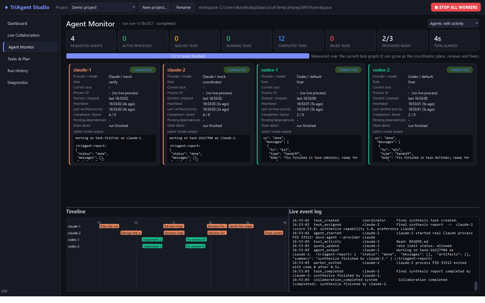

# TriAgent Studio



A Windows desktop application that orchestrates AI coding-agent CLIs as one team:

* **Anthropic Claude Code** (`claude -p --output-format stream-json`), using your Claude
  subscription login
* **OpenAI Codex CLI** (`codex exec --json`), using your ChatGPT subscription login
* **Google Antigravity**: the panel is shown, but marked **UNSUPPORTED**. Google's published
  terms do not permit third-party applications to wrap the Antigravity consumer-account CLI, so
  TriAgent Studio never launches, tests or controls it, and attempts no workarounds.

You describe the objective, set agent counts per provider, and press **Start Collaboration**. An AI
coordinator decomposes the objective into a task graph. The engine then assigns tasks to agents
by capability and workload, launches real CLI processes, and routes explicit messages between
agents. It also runs cross-provider review → fix → re-review cycles and records everything
durably in SQLite.

---

## 1. Installation

Requirements: Windows 10/11, Python 3.11+ (developed and tested on 3.14), and at least one
provider CLI that you are already signed in to.

```powershell
cd TriAgentStudio
py -3 -m venv .venv
.venv\Scripts\python -m pip install -r requirements.txt
```

Provider CLIs (each uses its **own official sign-in**; TriAgent Studio never reads credentials):

| Provider | Install | Sign in |
|---|---|---|
| Claude Code | https://docs.claude.com/en/docs/claude-code (`irm https://claude.ai/install.ps1 \| iex`) | run `claude`, then `/login` with your Claude subscription |
| Codex CLI | https://developers.openai.com/codex/cli (`npm install -g @openai/codex`) | `codex login` → *Sign in with ChatGPT* |
| Antigravity | not integrated: unsupported (see above) | n/a |

## 2. Launching

| Way | Command |
|---|---|
| From source | double-click **`TriAgentStudio.bat`** (creates `.venv` on first run) or `.venv\Scripts\pythonw launch_triagent.py` |
| Packaged executable | `dist\TriAgentStudio\TriAgentStudio.exe` |
| Build exe + desktop shortcut | `powershell -ExecutionPolicy Bypass -File build.ps1 -Shortcut` |

On first launch a **setup wizard** detects Python, the Claude and Codex CLIs, their supported flags, sign-in
status, filesystem permissions and workspace access, and then creates your first project.

## 3. Projects and folders

* **Default project storage.** The first launch creates
  `Documents\TriAgent Studio Projects\`, resolved with `QStandardPaths`, so a redirected
  Documents folder works too. **New Project** creates a properly named subfolder there, such as
  `Calculator App\`, registers the project and selects it. An existing non-empty folder is
  never reused implicitly; you get `Name (2)` instead. You can still choose any other folder,
  and Settings → *Folders & About* lets you change the default location.
* **Automatic restore.** On start the last project is reopened with its folder, prompts, agent
  counts, settings, task history and conversations. Opening the app **never** starts agents or
  runs commands.
* **Dashboard project card.** It shows the name, absolute folder, configured agents, status,
  last activity and a *Recent projects* dropdown. It has these buttons:
  * **Open Project Folder** and **Open Output Folder** (`<project>\output`, created when
    needed; agents are asked to put deliverables there);
  * **Open Application Folder** (the folder containing `TriAgentStudio.exe`, also in
    Settings → Folders & About);
  * **New Project** and **Switch Project**.

  Folders open in Explorer through `QDesktopServices.openUrl(QUrl.fromLocalFile(...))` with
  absolute paths; the current working directory is never used.
* **Generated files.** In *Tasks & Plan*, a completed task lists the files it produced, each with
  an open link and a link to its folder.
* **Invalid or missing project folder.** A yellow banner, and a prompt at start, explain the
  problem and offer **Use Default Projects Folder**, **Choose Another Folder** and **Open
  Application Folder**. A missing folder can also be recreated in place. Nothing is moved or
  deleted, and the project keeps its prompts, settings and history. A new folder needs its
  workspace-access decision again.
* **Never a workspace:** the application's own folders (`dist`, `build`, `_internal`, `.venv`,
  or the folder of the packaged exe) are replaced on rebuild or update. You can still open them;
  they just cannot hold project files. `build.ps1` refuses to rebuild while a project lives
  there.
* **Where data lives.** Projects, databases, transcripts and approvals are stored in
  `%APPDATA%\TriAgentStudio`, independent of the executable, so they survive rebuilds and
  updates.

## 4. Operating the application

1. **Project & workspace.** Use *New project…* or *Select Project Directory*. Each project has its
   own isolated database (tasks, messages, events, runs, prompts, settings, artifacts).
2. **Dashboard.** There is one panel each for CLAUDE, CODEX and ANTIGRAVITY, showing:
   * agent count, an enable toggle and the model;
   * installed version, authentication, and READY/INSTALLED/… status;
   * requested, running (live processes only), queued, done and failed counts;
   * usage/quota, shown only when the CLI reports it officially (for example Claude's
     `rate_limit_event`); otherwise *Unknown*.

   The **global concurrency limit** caps simultaneous CLI processes. You can configure 25 + 25 + 25
   agents while only N run at once; the rest wait in the queue.
3. **Project objective.** Describe the goal on the dashboard.
4. **Open Prompt Editor.** This opens a separate window with four large editors (A. Global/Shared,
   B. Claude, C. Codex, D. Antigravity) plus Save, Load, Templates, Clear, Validate and Start
   Collaboration. Prompts are saved per project and restored automatically:
   * saving is revision-checked, so a prompt changed elsewhere is never silently overwritten;
   * every saved version is kept in history.
5. **Workspace access.** Choose *Full Workspace Access*, *Manual Approval* or *Read Only*,
   either on the dashboard or in Settings → Permissions. The choice is saved per project and per
   workspace. Projects that already ran collaborations in their workspace count as trusted and
   default to Full Workspace Access. A new workspace, or a changed one, asks before the first run.
6. **Start Collaboration.** You confirm the workspace, providers and access mode, and the run
   starts. In **Automatic** mode (the default) the coordinator plans. **Manual** mode (advanced)
   uses the tasks you add in *Tasks & Plan*.
7. Watch progress in these views:
   * **Live Collaboration** is a chronological stream of real CLI output, explicit inter-agent
     messages (with delivery status), tool activity summaries and orchestration events. It has
     filters for provider, recipient/team, agent, task, type, time and text, plus expandable task
     threads, copy, and export to Markdown/JSON.
   * **Agent Monitor** shows per-agent panels with real PID, start/elapsed time, heartbeat, last
     verified activity, current task, pending dependencies, latest output and state. It also has
     global tiles, a task-graph progress bar (measured work units only), a timeline and a live
     event log.
   * **Tasks & Plan** shows the live task graph with dependencies and assignments, plus add,
     retry, cancel and reassign.
   * **Approvals** lists real pending permission requests, with a counter in the navigation and
     a desktop notification. Each entry shows the agent, requested operation, target path, risk
     explanation and mechanism, with **Approve Once / Reject**. Manual-action items have
     **Retry task / Cancel task** instead. The full approval history is persisted.
   * **Run History** lets you reopen old runs, resume stopped/interrupted runs, export, and
     preview artifacts, outputs, prompts and transcripts.
8. Run controls are **Pause** (no new tasks start), **Resume**, **Stop** (graceful; unfinished
   tasks return to the queue and the run is resumable) and the red **STOP ALL WORKERS**
   (emergency kill of every worker process tree, also `Ctrl+Shift+X`).

## 5. How collaboration works

```
GUI (PySide6) ── AppController ── Engine thread (per project) ── Supervisor ── real CLI processes
                     │                    │                             (stdout reader threads)
                     └── SQLite WAL (project.db): runs, agents, tasks, task_deps, messages,
                         message_deliveries, events, artifacts, worker_procs, provider_state
```

* **Coordinator planning.** The first task is a `plan` task for the coordinator provider (default
  Claude). Its report contains a task graph (`tasks` with kind, provider, depends_on, files,
  parallel). The graph is validated (it must be a DAG, stay within the task budget, and use known
  kinds and providers) and is then persisted.
* **Assignment.** Each READY task goes to the best idle agent. The score combines the
  provider-capability matrix (editable), the planner's preference, the agent's workload and
  failure history, and provider backoff and concurrency limits. Reviews are forced onto a
  *different provider* than the change author whenever one is available.
* **Atomic claiming and leases.** `UPDATE … WHERE status='READY'` gives exactly one winner.
  Leases are renewed while the process is alive; expired leases are recovered. Completion is
  idempotent: only the current lease owner can complete a task.
* **Messages.** Agents end every run with a `<triagent-report>` JSON block. It holds a summary,
  messages to `agent:<id>`, `team:<provider>` or `all`, artifacts, verdict/defects, and proposed
  follow-up tasks.
  * Messages are persisted and injected into the recipient's **next actual task invocation**,
    marked as `<untrusted-data>`.
  * Deliveries are recorded per agent. Nothing is fabricated: the GUI shows exactly what each CLI
    produced. Hidden reasoning (Claude `thinking` blocks, Codex `reasoning` items) is never
    displayed.
* **Handoffs.** A task's prompt includes the result summaries of the tasks it depends on.
* **Review loop.** Every implement/fix task automatically gets a cross-provider review.
  `changes_requested` routes the defects to the implementing agent and creates a fix task, which
  is reviewed again, up to *max review rounds*. Downstream tasks are rewired to wait for the
  review chain.
* **Replanning.** Permanent failures, blocked dependencies and failed verification trigger a
  bounded `replan` task for the coordinator, which may cancel obsolete tasks and add new ones.
* **Loop prevention.** The following are all bounded: task budget, review rounds, replans, the
  depth of agent-proposed follow-ups, and messages per task.
* **Conflict prevention.** Concurrent write tasks must declare disjoint file scopes, and write
  tasks without a scope are exclusive. Read-only tasks run in parallel.
* **Recovery.**
  * Worker PIDs and their creation times are persisted.
  * When a project is opened, orphaned workers from a crashed session are terminated
    (PID-reuse safe), and runs are marked *interrupted* with their tasks requeued, so they can be
    resumed.
  * Rate limits and connection errors put only the affected provider into exponential backoff,
    using the reset time when the CLI reports one; the other providers keep working.
  * Timeouts and stalls kill the process tree, and the task is retried, possibly on another agent.

## 6. Safety and billing boundaries

### 6.1 Workspace permission modes (real CLI mechanisms, verified on the installed versions)

| | Full Workspace Access (default for trusted projects) | Manual Approval | Read Only |
|---|---|---|---|
| **Claude Code** | `--restricted` (file tools confined to the workspace) + `--permission-mode auto` (Claude's automatic permission handling) + tools Read/Glob/Grep/Edit/Write/Bash | `--restricted` + `--permission-mode default`: every edit/command becomes a live prompt in the Approvals tab | `--restricted`, tools Read/Glob/Grep only |
| **Codex** | `--approve-for-me` (workspace-write OS sandbox + Codex's automatic review) | `--sandbox read-only` until you approve a **one-time** `workspace-write` launch for the task | `--sandbox read-only` |
| **Tasks** | design/implement/fix/test: write + run; review/verify: run; plan/research/synthesize: read | same access classes, gated by approvals | everything read-only; implementation tasks return proposals |

In every mode:

* **Secret files** (`.env*`, keys, certificates, credentials, `.npmrc`, `.ssh`, `.aws`, …) are
  hard-denied for Claude through `deny` rules supplied with `--settings`.
* **High-risk commands** cover publishing and deployment (`git push`, `npm publish`,
  `docker push`, `vercel`, `terraform apply`, cloud CLIs), destructive commands
  (`rm -rf`, `Remove-Item -Recurse`, `git reset --hard`, `format`), privilege elevation, registry
  changes, network transfer (`curl`, `wget`, `Invoke-WebRequest`) and payment CLIs (`stripe`).
  * **For Claude** they are `ask` rules, so each one needs separate approval in the Approvals tab.
  * **For Codex** they are `forbidden` rules in `<workspace>/.codex/rules/triagent.rules`, because
    `codex exec` cannot forward approvals. TriAgent Studio writes only that one file, and Codex
    honors it.
* **Directories outside the workspace** are refused: by `--restricted` for Claude and by the
  Codex sandbox. An extra directory needs explicit approval under Settings → Permissions →
  *Additional allowed directories* (passed to Claude as `--add-dir`).
* **Never used:** `bypassPermissions`, `--dangerously-skip-permissions`,
  `--dangerously-bypass-approvals-and-sandbox`, yolo or overage flags. Read Only and Manual
  Approval are always available.

### 6.2 Approvals: what each button really does

* **Claude prompts.** Claude workers run with `--input-format stream-json --permission-prompts
  host --permission-prompt-tool stdio`, the CLI's documented host permission protocol.
  * When Claude needs permission, it sends a `can_use_tool` control request and **waits**. The
    request is stored, shown in the Approvals tab and announced with a desktop notification.
  * **Approve Once** sends `allow` for that single tool call over the process's stdin;
    **Reject** sends `deny` with your reason.
  * Timeouts are paused while a request waits for you.
* **Codex launch grants** (Manual Approval mode). The task stays **BLOCKED** and no process
  starts. *Approve Once* starts that task one time with `--sandbox workspace-write`; *Reject*
  cancels it.
* **Not forwardable.** This covers a Codex mid-run refusal (sandbox or rules) and a hard-denied
  Claude operation. The task is marked **BLOCKED** with a *manual approval path*: do it yourself
  and click *Retry task*, change the permission mode or allowed directories, or cancel. No
  approval is ever simulated.
* **Completion and history.** A run never completes while approvals or manual actions are
  pending. Every request and decision (approved, rejected, expired or resolved) is persisted
  per project.

### 6.3 Artifact verification

Every write task must declare the files it creates, such as `DESIGN.md`. Before a task is
marked COMPLETED, and before any dependent review is scheduled, TriAgent Studio checks that
every declared and reported file exists in the canonical workspace. Missing files mean the task
is retried, not accepted. Every agent receives the same resolved workspace path as its working
directory and in its prompt.

### 6.4 Other boundaries

* Denied tool calls are shown as **Permission required** events; nothing is bypassed silently.
* **Subscription use (no API billing by default).**
  * AI-provider API keys (`OPENAI_API_KEY`, `CODEX_API_KEY`, `ANTHROPIC_API_KEY`,
    `ANTHROPIC_AUTH_TOKEN`, `GEMINI_API_KEY`, `GOOGLE_API_KEY`) are removed from every worker
    process's environment. Each worker gets a *copy* of your environment; your own environment
    (current process and persistent user variables) is never modified, and all other variables
    pass through unchanged.
  * Codex workers are additionally started with `-c forced_login_method=chatgpt`. Codex itself
    then refuses API-key authentication. This setting was verified as a recognized, validated
    config field of Codex 0.166 (`--strict-config` accepts it and rejects invalid values).
  * Detection runs `codex login status` and `claude auth status` with the same sanitized worker
    environment. Their output is redacted and only the auth method is kept; no credentials are
    read or logged. Codex is READY only for a ChatGPT login, and Claude only for a `claude.ai`
    subscription login.
  * Paid API billing (Claude/Codex) is possible only after an explicit opt-in in Settings with a
    confirmation. It is off by default and was not enabled during testing.
* Codex outside a git repository requires an explicit choice: run `git init` (recommended), allow
  it for this project, or skip Codex.
* Prompts go to CLIs over **stdin**, never through a shell. Model names and tool patterns are
  validated. Agent-reported artifact paths outside the workspace are rejected. Logs, messages and
  transcripts are passed through secret redaction.
* System directories, drive roots and the whole user profile are refused as workspaces.

## 7. Mock providers (quota-free testing)

*Settings → Reliability → Mock providers* replaces the Claude and Codex CLIs with a built-in
mock agent (Antigravity stays UNSUPPORTED in mock mode too). It
is a **real child process** that emits each provider's genuine wire format, so the full desktop
workflow (planning, messages, reviews, fixes, failures, rate limits and recovery) can be exercised
without consuming quota. Mock status is always labelled `(MOCK)` in the UI.

## 8. Tests

```powershell
$env:QT_QPA_PLATFORM="offscreen"; .venv\Scripts\python -m pytest -q
.venv\Scripts\python scripts\real_smoke.py         # real 1 Claude + 1 Codex: handoff, persistence, Stop All, auth hygiene
.venv\Scripts\python scripts\real_acceptance.py    # real automatic run, Claude 2 + Codex 2
.venv\Scripts\python scripts\diagnose.py           # detection only, no prompts sent
.venv\Scripts\python scripts\real_permissions.py   # real calculator workflow + approvals (Claude + Codex)
.venv\Scripts\python scripts\packaged_smoke.py     # packaged exe: folder buttons open real Explorer windows
```

`docs/TEST_REPORT.md` contains the actual results and the verified integrations.

## 9. Project layout

```
triagent/
  app.py                   entry point (also `--mock-agent` mode for the packaged exe)
  core/  db.py repo.py     SQLite WAL store + data access (claims, leases, bus, events)
         engine.py         orchestration engine (planner, assigner, reviews, replans, recovery)
         supervisor.py     real subprocess management, process-tree termination
         protocol.py       prompt composition, report parsing, plan validation
         safety.py         redaction, environment sanitization, path checks
         projects.py settings.py export.py models.py
  providers/ claude.py codex.py antigravity.py mock.py mock_agent.py base.py
  ui/      main_window.py prompt_editor.py collaboration_view.py monitor_view.py
           tasks_view.py history_view.py diagnostics_view.py settings_dialog.py setup_wizard.py
tests/     unit, provider, engine end-to-end and GUI tests
scripts/   real_smoke.py real_acceptance.py make_icon.py
```

Application data lives in `%APPDATA%\TriAgentStudio` (`registry.db`, and `projects\<id>\project.db`
plus `runs\<run>\{prompts,outputs,transcripts}`). Workspaces are not used for state.

## 10. Implementation notes and decisions

* **PySide6 + SQLite WAL + managed subprocesses**, as requested. One engine thread per project.
  The GUI polls the database every 500 ms, so the GUI thread never blocks on workers.
* **One CLI invocation per task.** Each task is a fresh, fully managed `claude -p` / `codex exec`
  process. An *agent* is a persistent identity whose messages, history and statistics carry
  across its invocations. Registered identities are never shown as running: "running" counts only
  live, supervised processes.
* **Separate git worktrees were not implemented.** Write conflicts are prevented by file-scope
  locking instead, because merging per-agent worktrees back automatically would itself be an
  unattended, conflict-prone write operation.
* **Windows folder permissions.** The Codex Windows sandbox writes files as a separate sandbox
  identity. In folders that grant you access only as their *owner* (for example folders created
  by Python's `tempfile.mkdtemp`), those files become unreadable for you and the other agents.
  Diagnostics and the start dialog detect this and show the `icacls` fix. Normal folders such as
  Documents and Desktop are fine.
* **Antigravity is disabled by design.** The adapter performs no subprocess calls at all:
  detection, connection test and worker launch are all refused, in mock mode too. Settings
  force Antigravity to disabled with 0 agents, even if an older project had it enabled. The
  prompt editor keeps editor D for completeness, but its contents are not sent anywhere.

---

## License and disclaimer

TriAgent Studio is released under the [MIT License](LICENSE).

It is an independent personal project and is not affiliated with, endorsed by or sponsored by
Anthropic, OpenAI or Google. Claude, Claude Code, Codex and Antigravity are trademarks of their
respective owners and are named here only to describe compatibility. TriAgent Studio drives each
provider's official CLI under your own sign-in; you are responsible for using those CLIs within
the provider's terms of service.
